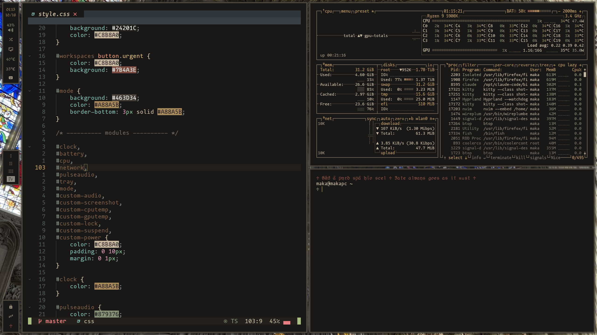
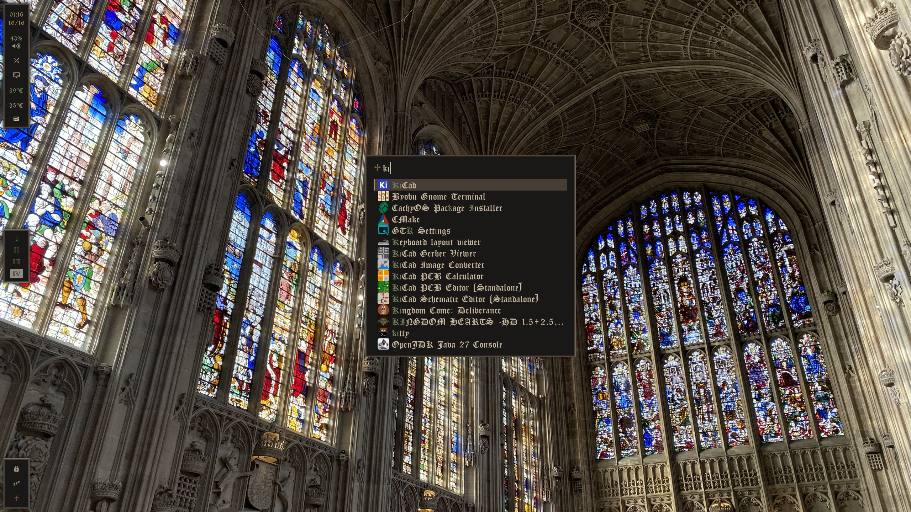
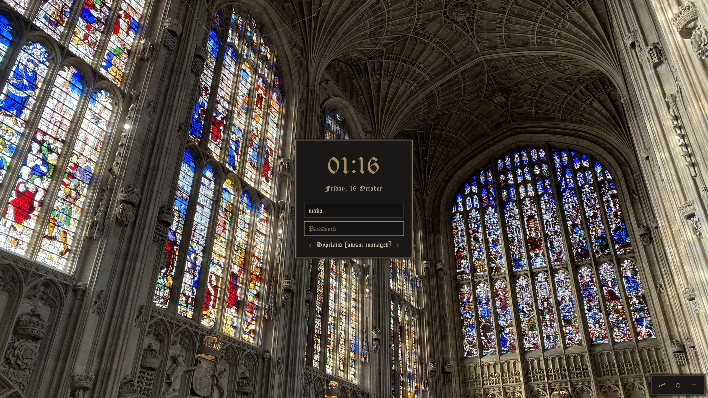
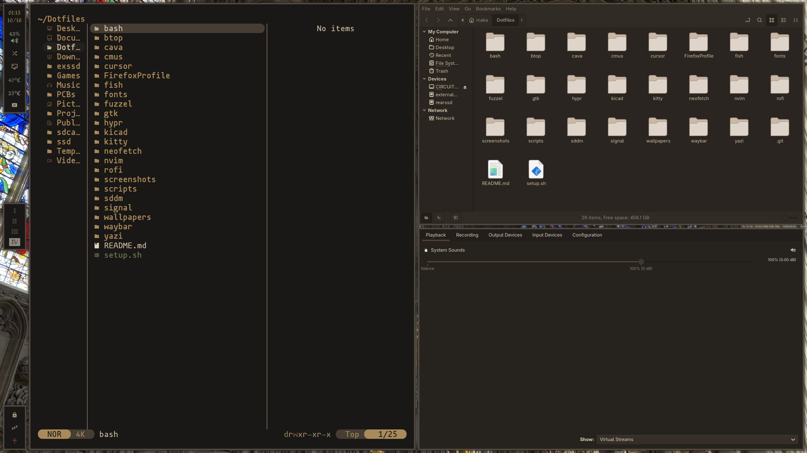
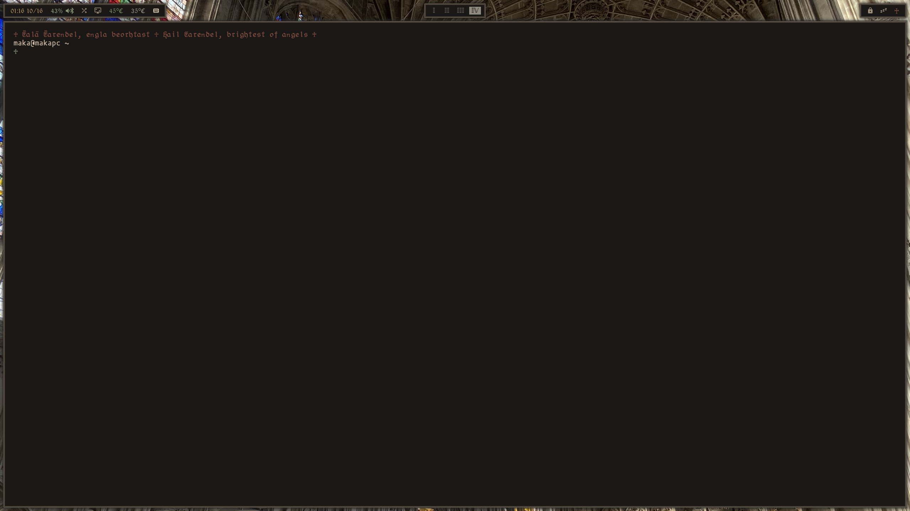
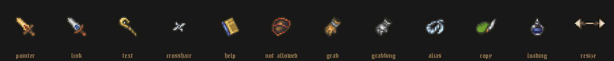

# ♰ dungeonOS ♰

*Ƿ𝖊𝖘 𝖍𝖆̄𝖑* (be well). These are my Hyprland dotfiles for CachyOS / Arch: one dungeon-synth themed setup with
warm stone-and-bronze colours, blackletter type, square double-ruled frames and pixel art, carried through
everything from the login screen to the cursor.



| | |
|---|---|
|  |  |
|  |  |



---

## The palette

| | | | |
|---|---|---|---|
| `#141210` bg dark | `#1A1816` bg | `#24201C` surface | `#463D34` band |
| `#7E705D` bronze | `#C8B8A0` fg | `#9D8E7C` muted | `#6F675E` comment |
| `#6E7F5A` moss | `#879376` sage | `#A88A5B` brass | `#7A5E47` clay |
| `#8F8B81` steel | `#7B4A3E` rust | | |

**Fonts:** CloisterBlack (blackletter) for UI text, azukifontB for the active workspace, Fantasque Sans
Mono (Nerd Font) in the terminal.

**The frame:** a 1px bronze line around a 3px `#463D34` band. Windows, waybar panels, rofi, the
lock screen and the login screen all share it, along with a soft drop shadow.

---

## What's themed

| Part | What it does | Files |
|---|---|---|
| **Hyprland** | 10px gaps everywhere; the double-rule frame on windows via the `borders-plus-plus` plugin (built by `setup.sh`); a scratchpad (Super+B) with Signal, cmus and btop; workspaces slide up/down or left/right to match the bar | `hypr/hyprland.lua` |
| **Waybar** | Three framed panels on the left edge (or along the top, see below): clock, volume, audio switch, screenshot, temperatures, tray, workspaces I–IV each with their own colour, lock, sleep, and a ♰ power button. Hover highlights are inset squares like the workspace squares | `waybar/` |
| **Lock / sleep** | hyprlock styled like the login screen (2× on 4K); hypridle locks before every sleep (button, lid, power key), locks after 10 min idle, and on the laptop suspends after 30 min | `hypr/hyprlock.conf`, `hypr/hypridle.conf` |
| **Login screen** | SDDM theme: cathedral wallpaper, framed panel, brass clock, session picker, power panel. Scales 2× on 4K screens | `sddm/` |
| **Cursor** | Final Fantasy Tactics item sprites (sword, silver sword for links, staff for text, shuriken crosshair, potions while loading, tome, shield, gauntlets, chain, quill); every other cursor recoloured into the palette. Pixel-sharp at size 64 | `cursor/dungeonOS-cursor-src/` |
| **Terminal** | kitty with the palette; fish greets you with a random Old English line and its translation (`♰ Hwæt! ♱ Listen! ♰`) | `kitty/`, `fish/`, `fish/greetings.txt` |
| **Neovim** | AstroNvim with the dungeonOS colours over everforest | `nvim/lua/plugins/darkshire.lua` |
| **rofi** | The launcher (Super+S), framed like everything else; matched letters in moss | `rofi/` |
| **btop, cmus, Yazi** | Themes in the palette (Yazi's 725 file icons recoloured too) | `btop/themes/`, `cmus/`, `yazi/` |
| **GTK** | A dungeonOS GTK3 and GTK4 theme (GTK's own dark themes, recoloured) for Nemo, pavucontrol and file dialogs | `gtk/` |
| **Signal** | Signal Desktop recoloured, re-applied automatically after every Signal update | `signal/` |
| **KiCad** | A colour theme for the schematic, PCB, footprint, 3D and Gerber views; KiCad's settings live here too. Plus the LCSC Part Finder plugin: a schematic toolbar button that finds the cheapest in-stock LCSC part for a symbol | `kicad/`, `kicad/plugins/` |

---

## Keys

| Keys | Action |
|---|---|
| Super + F | Terminal (kitty) |
| Super + S | App launcher (rofi) |
| Super + T | Firefox |
| Super + D / Super + E | Yazi / Nemo |
| Super + R | Close window |
| Super + A | Fullscreen |
| Super + G | Float / tile window |
| Super + L | Lock screen |
| Super + B | Scratchpad (Signal, cmus, btop) |
| Super + Shift + B | Move window to the scratchpad |
| Super + 1–0 | Go to workspace 1–10 (or click it in the bar) |
| Super + Shift + 1–0 | Move window to workspace 1–10 |
| Super + arrows | Move focus |
| Super + scroll | Next / previous workspace |
| Super + drag | Move (left button) / resize (right button) |
| Super + Escape | Switch audio output |

---

## Scripts

| Script | What it does |
|---|---|
| `scripts/waybar-toggle.sh` | Switches waybar between vertical (left, the default) and horizontal (top), and turns the workspace animation to match. Remembered across reboots |
| `scripts/waybar.sh` | (Re)starts waybar in the remembered layout; run at login |
| `scripts/lock.sh` | Locks the screen with hyprlock at the right size: doubles it on 4K, the same as the login screen |
| `scripts/scratchpad.sh` | Opens Signal, cmus and btop in the scratchpad in a fixed order (safe to rerun) |
| `scripts/cputemp.sh`, `gputemp.sh` | Temperatures for waybar (AMD, Intel or NVIDIA) |
| `scripts/toggle-audio.sh` | Swaps between my two audio outputs |

---

## Installing

```sh
git clone git@github.com:Maka8295/Dotfiles.git ~/Dotfiles   # it has to live at ~/Dotfiles
cd ~/Dotfiles && ./setup.sh                                  # --no-packages to skip installing
```

`setup.sh` is safe to rerun. Anything already in the way is moved to `<name>.bak-<date>` instead of being
deleted. It:

1. installs the packages (`pacman -Syu`, plus `paru` for AUR ones),
2. links every config folder into `~/.config`,
3. installs the fonts, the cursor and the GTK theme,
4. builds the Hyprland border plugin,
5. installs the login screen and the Signal theme (these two ask for your password),
6. sets fish as your shell.

At the end it tells you whether to reboot (only when the kernel was updated) or just log out and back
in to the Hyprland session.

**Laptop:** the config adapts to any screen. My ThinkPad T14 Gen 2 (4K) gets an exact scale 2 so the
pixel art stays crisp; any other monitor gets its best mode and automatic scale. The login screen
doubles its size on 4K, and btop picks a smaller font on smaller screens.

**After updates:** the border plugin is compiled for one exact Hyprland version, so rerun
`hypr/plugins/build.sh` after updating Hyprland. Several themes are generated from the apps' own
files and can be rebuilt with:

- `gtk/make-theme.py` (after a GTK update),
- `yazi/make-icons.py` (if Yazi adds file types),
- `kicad/make-theme.py` (to tweak the KiCad colours),
- `cursor/dungeonOS-cursor-src/build.py` (after editing the cursors).

---

## Credits

- Item sprites from *Final Fantasy Tactics* © Square Enix, via The Spriters Resource
- Original cursor base: the Hatsune Miku pixel cursor theme
- Wallpaper: King's College Chapel, Cambridge
- Fonts: CloisterBlack, azuki, mononoki (see `fonts/`), Fantasque Sans Mono (`ttf-fantasque-nerd`)
- `borders-plus-plus` from [hyprwm/hyprland-plugins](https://github.com/hyprwm/hyprland-plugins)
- Old English lines from *Beowulf*, *The Wanderer*, *The Seafarer*, *Deor*, *The Battle of Maldon*,
  *The Dream of the Rood*, *The Ruin*, *Maxims II*, *Wulf and Eadwacer*, *Cædmon's Hymn*, the
  *Rune Poem*, the Exeter Book riddles, *Christ I* and the *Æcerbot* charm
